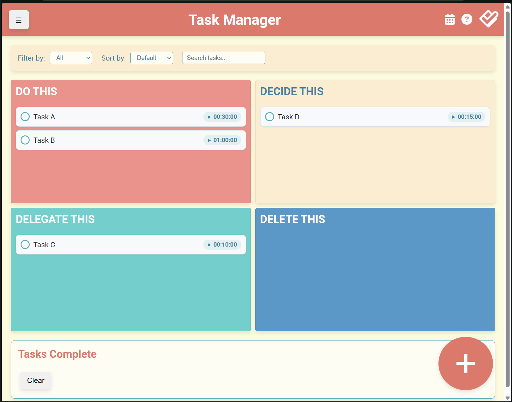
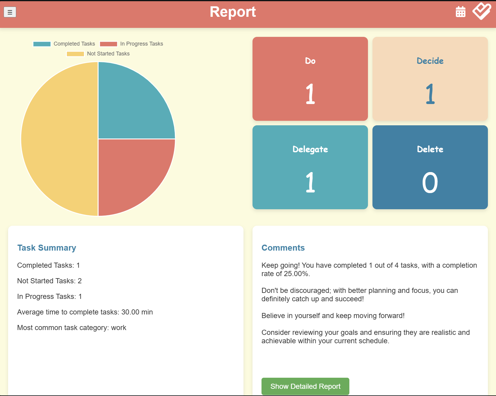
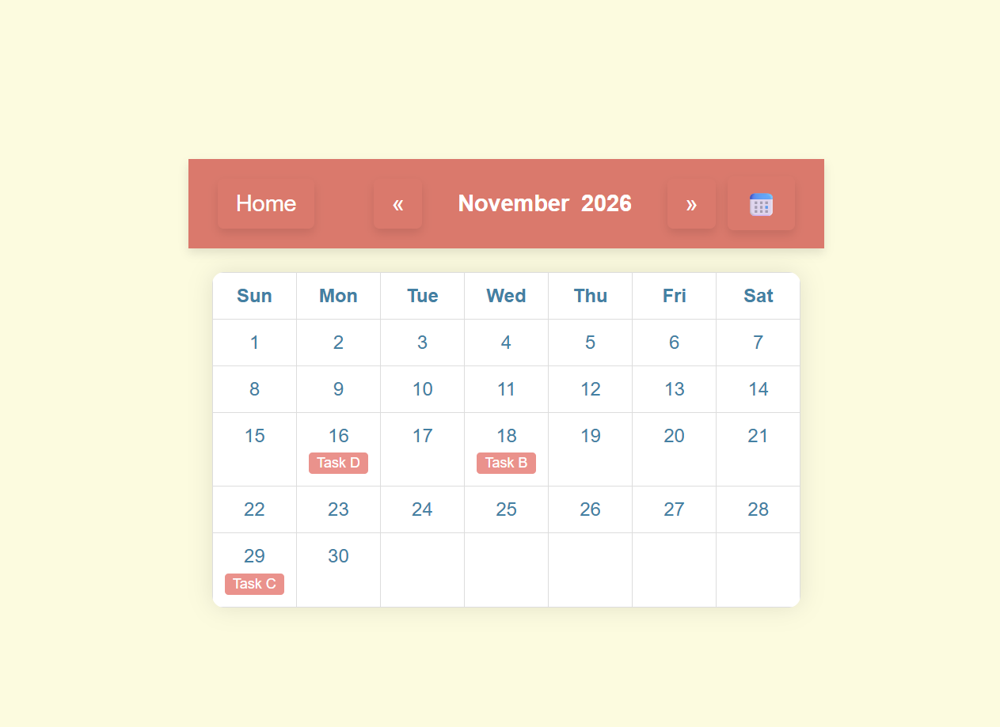

# Priority Matrix Planner

This is a task planner built around the **Eisenhower Matrix**. Every task goes into one of four boxes based on two questions: is it **urgent**, and is it **important**?

| | Urgent | Not urgent |
|---|---|---|
| **Important** | **Do** it now | **Decide** when to do it |
| **Not important** | **Delegate** it | **Delete** it |

Urgent things are not always important. Sorting tasks this way helps you spend your time on what really matters, instead of just reacting to whatever feels most pressing.

> Originally built in 2024 as class project called *Task Booster Assistant*, then moved to this repository and added small backend

## What you can do

- Add a task and choose how urgent and important it is. It goes into the right box automatically.
- Click the circle to finish a task, click its name to edit it, and click the time to start a timer.
- Drag a task to move it to another box.
- See your tasks by deadline on the **Calendar** page.
- See charts of your progress on the **Reports** page.

